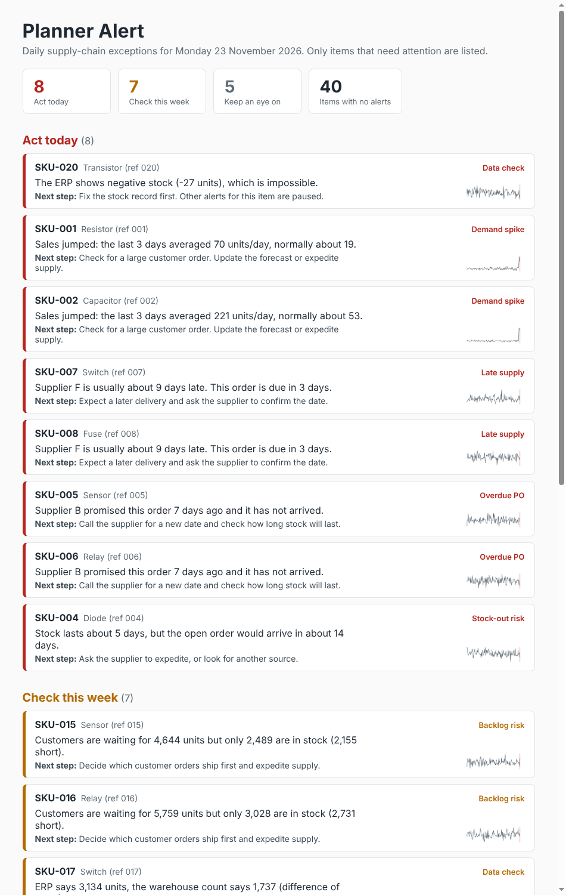

# Planner Alert

A planner checks hundreds of items every day, mostly to find out that nothing is wrong. Planner Alert does that check automatically and shows only the items that need attention, each with the reason in plain words and a suggested next step.



## How it works

1. **Load the data.** Three tables, the kind a planner already exports from an ERP: items, daily sales, open purchase orders.
2. **Check the data first.** Negative stock, ERP vs warehouse mismatches, and duplicated orders are flagged, and those items are paused for the other rules, because alerts built on bad numbers would mislead.
3. **Run the rules.** Each item is tested against the rules below.
4. **Rank.** Each alert gets a priority: High (act today), Medium (check this week), Low (keep an eye on).
5. **Report.** A single HTML file (open it in any browser) plus `alerts.csv` for Excel.

## The alerts

| Alert | Question it answers | Triggers when |
|---|---|---|
| Data check | Can I trust the numbers? | Stock is negative, ERP and warehouse differ by more than 10%, or a PO is listed twice |
| Demand spike | Did sales suddenly jump? | Last 3 days are far above the item's own normal (median/MAD z-score above 3.5) |
| Stock-out risk | Will we run out before the next delivery? | Days of stock (on hand / last 14 days of sales) is less than the days until supply arrives. Arrival = promised date + the supplier's usual delay, or the full lead time if nothing is on order |
| Overdue PO / Late supply | Is a supplier order late? | Promised date has passed, or the supplier is usually 4+ days late and the order is due within 10 days |
| Backlog risk | Are customers waiting for stock we don't have? | Open customer backlog is larger than stock on hand |
| Forecast gap | Is the forecast wrong? | Forecast and the last 14 days of real sales differ by more than 30% |
| Overstock | Too much stock? | More than 75 days of stock (shows the money tied up) |
| Slow-moving stock | Stock that doesn't sell? | No sales for 45+ days |

All thresholds are named constants at the top of `planner_alert/detect.py`.

## The sample data

Everything is synthetic: no real company data. 60 items of electronic components. Items 1 to 20 each have one deliberate problem (two per alert type, so every alert shows up in the demo). Items 21 to 60 are healthy on purpose, to show that the tool stays quiet when nothing is wrong. A test checks that all 20 planted problems are found and that there are no false alarms.

Write it out as CSV files with `python -m planner_alert.run --save-sample sample_data`.

| File | One row per | Columns |
|---|---|---|
| `skus.csv` | item | `sku`, `description`, `unit_cost`, `lead_time_days` (days to get a new order), `safety_stock` (minimum buffer), `on_hand` (ERP stock), `on_hand_wms` (warehouse count), `backlog_qty` (customer units waiting), `forecast_daily` (forecast units/day) |
| `demand.csv` | item per day | `date`, `sku`, `demand` (units sold, 120 days) |
| `open_pos.csv` | open purchase order | `sku`, `supplier`, `po_qty`, `promised_date`, `supplier_avg_delay_days` (how late this supplier usually is) |

Only the columns in `REQUIRED` (see `data.py`) are mandatory. Optional ones (cost, warehouse count, backlog, forecast) switch on the extra alerts when present.

## Run it

```bash
pip install -r requirements.txt
python -m planner_alert.run                    # demo, writes report.html and alerts.csv
python -m planner_alert.run --data my_folder   # your own CSV files
pytest                                         # 12 tests
```

## Roadmap

- Daily delivery by email, Slack or an n8n workflow
- Seasonality-aware baselines
- Learn from planners which alerts they act on and drop the noisy ones
